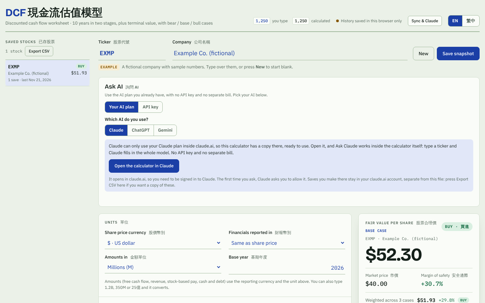
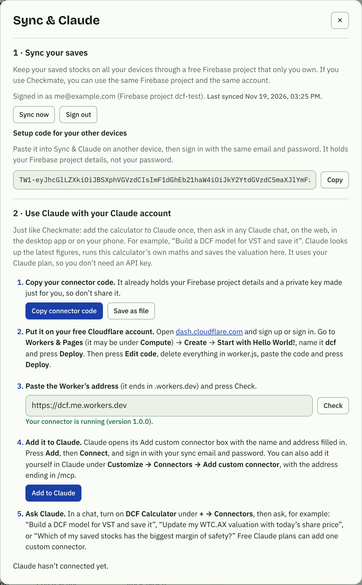

# DCF Stock Valuation Calculator · DCF現金流估值模型

A free calculator that estimates what one share of a company is worth, based on the cash the business is expected to bring in over the next ten years. It started life as a Google Sheet and now opens as a page in your web browser, in English or Traditional Chinese.

## Open it

1. Download the calculator. Under **Releases** on this page, open the newest one and download the file ending in **.html**, for example **dcf-calculator-v1.4.0.html**. (The file called **index.html** in the list above is the same thing, always the newest version.)
2. Double-click it. It opens in your web browser (Chrome, Safari, Edge or Firefox).

There is nothing to install and no account to create. The calculator opens with a made-up example company so you can see how it works. Press **New** to start your own.

## Value a stock in five steps

1. **Type the ticker and company name** at the top, for example NVDA and NVIDIA.
2. **Choose the units.** Pick the currency of the share price and the unit the company's report uses, usually millions. If the report uses a different currency from the share price (for example, a company that reports in US dollars but trades in Australia), choose the report's currency and type in the exchange rate.
3. **Copy in the company's numbers** from its latest annual or quarterly report. The table below shows where to find each one.
4. **Set your growth guesses** for three outcomes: bear (things go badly), base (most likely) and bull (things go well).
5. **Read the result** on the right, then press **Save snapshot** to keep a dated copy.

Tips:

- Press Enter to jump to the next box, like in a spreadsheet.
- Type numbers the way they appear in reports: 1,250 or 1.2B or 25億. Use (120) or -120 for a negative number.
- Type percentages as plain numbers: 12 means 12%. If you type 0.12, the calculator asks whether you meant 12%.

## The numbers you copy from the report

| Box | What it means | Where to find it |
|---|---|---|
| Free cash flow | Cash the business kept over the last 12 months after paying for buildings and equipment | Cash flow statement: "cash from operations" minus "capital expenditure" |
| Revenue | Total sales over the last 12 months | Income statement |
| Stock-based compensation (optional) | Pay given to staff in shares instead of cash | Cash flow statement |
| Cash & investments | Cash in the bank plus short-term investments | Balance sheet |
| Total debt | Loans and bonds the company must repay, not every bill it owes | Balance sheet: short-term plus long-term debt |
| Shares outstanding | How many shares exist | Front page of the report, or any stock website |
| Current share price | Today's price | Any stock website or your broker |
| Dividend per share (optional) | Dividends paid per share over the last year | The company's news releases |

## Your guesses

- **Growth, years 1–5 and 6–10:** how fast free cash flow grows each year. Growth usually slows as a company gets bigger.
- **Revenue × free cash flow margin:** a second way to look ahead, useful when a company's profits are unusually low or high right now. You set how fast sales grow and how much of each dollar of sales becomes free cash flow once things settle down.
- **Terminal growth:** growth after year 10, forever. Most people use 2–3%, about the pace of the wider economy.
- **Discount rate:** the yearly return you want from the investment. 8–12% is common. A higher number gives a lower value.
- **Bear, base and bull:** three versions of the future, each with its own guesses and a weight for how likely you think it is.

## Reading the result

- **Fair value per share:** what one share is worth if your guesses come true.
- **Margin of safety:** how far the fair value is above (+) or below (−) today's price.
- **BUY / HOLD / SELL:** by default, BUY needs a margin of safety of at least 25%, and SELL shows at −10% or worse. You can change both levels. Set both to 0 to match the original Google Sheet.
- **Weighted value and range:** the three outcomes blended by your weights, plus the lowest and highest values.
- **Price implies:** the growth that today's share price already assumes. If that looks too easy or too hard to achieve, it tells you something about the price.
- **Dividend checks:** the dividend yield, whether free cash flow is enough to pay the dividend, and a second estimate of value based only on dividends.
- **10-year projection and Sensitivity:** the year-by-year numbers, and how the value would change with a slightly different discount rate or terminal growth.
- **Input checks:** warnings when something looks wrong, such as a percentage typed the wrong way or numbers in mismatched units.

## Saving your work

- **Save snapshot** keeps a dated copy, grouped by ticker in the list on the left. Open a stock there to see every save, a chart of fair value against the share price over time, and buttons to load or delete each save.
- **Export CSV** saves your whole history as a spreadsheet file that opens in Excel or Google Sheets.
- Your saves stay on this computer, in the web browser you used, unless you turn on sync (below). Without sync they don't move to another computer or browser, and clearing your browser's history and site data erases them. Export now and then to keep a copy.

## Sync between your devices (optional, about 5 minutes)

Your saves can follow you to your other computers and your phone through a free Firebase project that only you own, so your saves never go to anyone else. **If you already use Checkmate, you can use the same Firebase project and the same account:** just paste Checkmate's setup code.

1. Create a free project at [console.firebase.google.com](https://console.firebase.google.com), turn on **Email/Password** sign-in and create a **Firestore** database.
2. In Firestore, open **Rules**, paste the rules the calculator shows you and press **Publish**.
3. In **Project settings**, copy the **firebaseConfig** block.
4. In the calculator, press **Sync & Claude** at the top, paste the block, type an email and a password, and press **Create account**.
5. On your other devices, paste the **setup code** that Sync & Claude shows, and press **Sign in** with the same email and password.

Under **How to set up sync**, the calculator lists every click. Saves you made before turning sync on are copied to your account.

## Language

Use the **EN / 繁中** button at the top right to switch between English and Traditional Chinese.

## Ask AI

An AI can do the research for you, using the AI plan you already pay for, so there's no API key and no separate bill. In the **Ask AI** panel, choose **Your AI plan** (the default), then pick the AI you use.

**Claude.** A Claude plan can only be used inside claude.ai: Anthropic doesn't let other apps, this calculator included, use it directly. So the calculator has a copy inside claude.ai, ready to use. Press **Open the calculator in Claude** and it opens there. Ask Claude then works inside the calculator itself: type a ticker and Claude fills in the whole model, or let it suggest assumptions, review your inputs and answer questions. You need to be signed in to claude.ai, and the first time you ask, Claude asks you to allow it. Saves you make there stay in your claude.ai account, separate from the downloaded file, so press **Export CSV** first if you want a copy of these. Claude inside claude.ai can't search the web, so check its figures against the latest report.

**ChatGPT or Gemini.** They can't work inside the calculator, so each button opens their chat with your request and your stock's numbers: **Build model**, **Suggest assumptions**, **Update figures + assumptions**, **Review my inputs** and **Ask**. They answer there and list the figures for you to type in. ChatGPT gets the request filled in. For Gemini it's copied, so paste it into the message box and send.

### Optional: let Claude save into the calculator by itself, just like Checkmate

This is the only part that needs Firebase (through sync) and a free Cloudflare account.

Add the calculator to Claude once. Then you can ask Claude in any chat, on claude.ai, in the desktop app or in the phone app, to value a stock. Claude finds the company's latest results, runs this calculator's own maths and saves the valuation to your calculator. A few seconds later it appears there, marked **Saved by Claude**. This uses your Claude plan, so you don't need an API key.

Things you can ask:

- "Build a DCF model for VST and save it."
- "Update my WTC.AX valuation with today's share price."
- "Which of my saved stocks has the biggest margin of safety?"
- "Delete my old NKE saves." (Claude checks with you first.)

Set it up once, in about 5 minutes. Sync has to be on first.

1. In the calculator, press **Sync & Claude**, then **Copy connector code**. The code already holds your Firebase details and a private key made just for you, so don't share it.
2. Sign up or sign in at [dash.cloudflare.com](https://dash.cloudflare.com). The free plan is enough. Go to **Workers & Pages** → **Create** → **Start with Hello World!**, name it **dcf** and press **Deploy**. Then press **Edit code**, delete everything in worker.js, paste the connector code and press **Deploy**.
3. Copy the address Cloudflare shows (it ends in **.workers.dev**), paste it into Sync & Claude and press **Check**.
4. Press **Add to Claude**. Claude opens its **Add custom connector** box with everything filled in. Press **Add**, then **Connect**, and sign in with your sync email and password.
5. In a Claude chat, turn on **DCF Calculator** under **+ → Connectors**, then ask away.

Good to know:

- Free Claude plans can add one custom connector. On Team and Enterprise plans, an owner adds it.
- The connector runs on your own Cloudflare account and signs in to your own Firebase project as you. Your password only goes to your Firebase project, never to Claude, and nothing is kept anywhere else.
- **Disconnect** in Sync & Claude stops Claude straight away, on every device. To undo it, connect again from Claude.
- When a new version of the connector comes out, the **Check** button tells you. Copy the code again, paste it over the old code in Cloudflare and press **Deploy**.
- A valuation is only as good as its figures and guesses. Check Claude's numbers against the company's own report.

### Or pay through an API key instead

If you'd rather Claude worked inside the downloaded calculator itself, switch the Ask AI panel to **API key**. This is billed separately by Anthropic, not through your Claude plan. On API key, the panel can:

- **Build a new model from a ticker:** type a ticker, such as NVDA or WTC.AX, and press **Build model**. Claude finds the company's latest figures, fills in every box and sets up the bear, base and bull outcomes. Everything it filled in is marked "Claude" until you change it, and **Undo** takes you back to what you had.
- **Suggest assumptions** or **Update figures + assumptions** for the stock on screen. You see each suggested change and choose which ones to keep.
- **Review my inputs:** a short list of what looks off and what to double-check.
- **Ask a question** about your valuation, such as "Is a 10% discount rate right here?"

In the downloaded calculator, the panel needs your own Anthropic API key. That's a private code that lets the calculator use Claude for you.

1. Go to [console.anthropic.com](https://console.anthropic.com), sign in or create an account, and add some credit.
2. Open **API keys**, create a key and copy it.
3. In the calculator, paste it into **Connect Claude with your API key** and press **Connect**.

Good to know:

- What you use is charged to that Anthropic account. It's separate from any claude.ai subscription.
- Claude can search the web, so it finds a company's latest results and share price. It's still worth checking the numbers against the company's own report.
- Your key is kept only in the web browser on your computer, and is only sent to Anthropic. Don't connect it on a computer other people use. Press **Disconnect** to remove it.
- If web search is switched off on your Anthropic account, Claude still works but uses what it already knows, which may be out of date. The calculator tells you when that happens.

If you open the calculator inside claude.ai instead, it uses your claude.ai account, and you don't need a key.

## Version history

The version you have is shown at the bottom of the calculator.

- **1.4.0** (21 November 2026): **Your AI plan** asks which AI you use. Claude opens the calculator inside claude.ai, where Claude works in the calculator itself on your Claude plan. ChatGPT and Gemini get each request in their own chat. The API key option is still there.
- **1.3.0** (19 November 2026): The Ask Claude panel now uses your Claude plan by default. It opens a Claude chat with your request, so you don't need an API key or a separate bill. The API key is still there as an option.
- **1.2.0** (19 November 2026): Use Claude with your Claude account, just like Checkmate. Ask in any Claude chat and the valuation appears in your calculator. Your saves can also sync between your devices through your own Firebase project.
- **1.1.0** (19 November 2026): Ask Claude now works in the downloaded calculator once you connect your own Anthropic API key, and Claude looks up the latest figures on the web.
- **1.0.0** (19 November 2026): the first public version.

When a new version comes out, download it the same way. Your saved snapshots stay in your web browser, so they're still there when you open the new file in the same browser.

## Please note

- A valuation is only as good as its guesses. Small changes to growth or the discount rate can move the result a lot, so check the Sensitivity table.
- This calculator is for learning and planning. It is not financial advice.

---

## 繁體中文說明

這是一個免費的股票估值計算機，依照公司未來十年預期帶來的現金，估算每一股的合理價。

**開啟方式：** 在本頁的 **Releases** 下載最新版本的 **.html** 檔案（例如 **dcf-calculator-v1.4.0.html**），雙擊就會在瀏覽器（Chrome、Safari、Edge 或 Firefox）中開啟，不需要安裝或註冊。按右上角的 **EN / 繁中** 可以切換語言。版本號碼顯示在頁面最下方，目前是 1.4.0。

**使用步驟：**

1. 在上方輸入股票代號和公司名稱。
2. 選擇股價幣別和財報單位（通常是百萬）。如果財報幣別和股價不同，請選擇財報幣別並輸入匯率。
3. 從最新財報填入自由現金流、營收、現金、負債、股數和股價。
4. 為悲觀、基本、樂觀三種情境填入成長率等假設。
5. 在右邊查看合理價和安全邊際，再按「儲存快照」保存。

**儲存：** 紀錄會存在這台電腦的這個瀏覽器裡。沒有開啟同步的話，換電腦、換瀏覽器或清除瀏覽紀錄後就會消失，建議定期按「匯出 CSV」備份。

**同步到所有裝置（選用，約 5 分鐘）：** 透過一個只屬於你的免費 Firebase 專案，讓紀錄出現在你的每部電腦和手機上。**如果你有用 Checkmate，可以用同一個 Firebase 專案和帳戶，直接貼上 Checkmate 的設定碼即可。** 按上方的「同步與 Claude」，計算機會列出每個步驟：建立 Firebase 專案、開啟 Email/Password 登入、建立 Firestore 資料庫並貼上規則、複製 firebaseConfig，然後按「建立帳戶」。在其他裝置貼上設定碼再登入。

**用你的 Claude 帳戶使用 Claude（和 Checkmate 一樣）：** 把計算機加到 Claude 一次，之後在任何 Claude 對話中（網頁、桌面 app 或手機 app）直接問，例如「幫 VST 建立 DCF 模型並儲存」。Claude 會查最新業績、用這個計算機本身的公式計算，並把估值存到你的計算機，幾秒後就會出現，標示為「Claude 儲存」。它使用你的 Claude 方案，不需要 API 金鑰。設定方法（需先開啟同步）：

1. 在計算機按「同步與 Claude」，再按「複製連接器程式碼」。程式碼已包含你的 Firebase 資料和專屬私密金鑰，請不要分享。
2. 到 [dash.cloudflare.com](https://dash.cloudflare.com) 註冊或登入（免費方案即可）。前往 **Workers & Pages** → **Create** → **Start with Hello World!**，名稱填 **dcf** 並按 **Deploy**。再按 **Edit code**，刪除 worker.js 的所有內容，貼上程式碼並按 **Deploy**。
3. 複製以 **.workers.dev** 結尾的網址，貼到「同步與 Claude」並按「檢查」。
4. 按「加到 Claude」，在 Claude 按 **Add**，再按 **Connect**，用同步的電郵和密碼登入。
5. 在 Claude 對話的 **+ → Connectors** 開啟 **DCF Calculator**，就可以開始問了。

你的密碼只會傳送到你自己的 Firebase 專案，不會給 Claude。在「同步與 Claude」按「中斷連接」可立即停止 Claude 的存取。

**詢問 AI：** 在「詢問 AI」面板選擇 **你的 AI 方案**（預設），再選你用的 AI，不需要 API 金鑰，也不會另外收費。

- **Claude：** Claude 方案只能在 claude.ai 裡使用（Anthropic 不允許其他 app，包括這個計算機，直接使用）。所以計算機在 claude.ai 有一個可以直接用的版本：按「在 Claude 開啟計算機」，「詢問 Claude」就能在計算機內運作，輸入股票代號，Claude 會填好整個模型。需要登入 claude.ai；在那裡的紀錄會留在你的 claude.ai 帳戶，和下載的檔案分開，如想保留這裡的紀錄，請先按「匯出 CSV」。
- **ChatGPT 或 Gemini：** 它們無法在計算機內運作，所以每個按鈕都會開啟它們的對話，帶入你的請求和數字；它們會在那裡回答，並列出數字讓你輸入。Gemini 的請求會複製，請貼上再傳送。

如果想讓 Claude 直接在計算機內工作，可以切換到 **API 金鑰**（由 Anthropic 另外收費）：

1. 到 [console.anthropic.com](https://console.anthropic.com) 登入或註冊，並加值。
2. 在 **API keys** 建立金鑰並複製。
3. 貼到計算機的「用你的 API 金鑰連接 Claude」，再按「連接」。

使用費用記在你的 Anthropic 帳戶，和 claude.ai 方案分開計算。金鑰只會存在你這台電腦的瀏覽器裡，也只會傳送給 Anthropic；請不要在共用電腦上連接，按「中斷連接」即可移除。在 claude.ai 裡開啟的版本則使用你的 claude.ai 帳號，不需要金鑰。

**注意：** 估值結果取決於你的假設，僅供學習和規劃參考，不構成投資建議。
